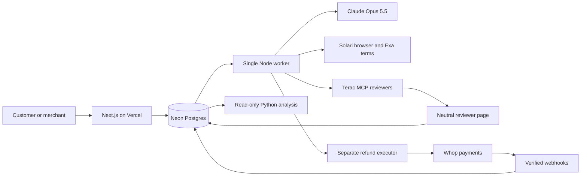

# Second Instance

**Independent human review, with the power to correct an AI decision.**

Second Instance gives customers a route to independent review when an AI denies a refund for a digital product. Reviewers apply the merchant's written policy; a separate executor can carry out an approved refund on Whop within the merchant's limits.

[Open the product](https://zero-human-peach.vercel.app/) · [Try the fictional store](https://zero-human-peach.vercel.app/refund) · [Agent ledger](https://zero-human-peach.vercel.app/ledger) · [Registered protocol](data/PREREGISTRATION.md)

## Why a human review

In Gartner's July 2024 survey figure, **60% of respondents to its AI-concerns question worried that reaching a person would become harder** (n=5,140; people unaware of AI were excluded from that figure). [Gartner's original release and survey figure](https://www.gartner.com/en/newsroom/press-releases/2024-07-09-gartner-survey-finds-64-percent-of-customers-would-prefer-that-companies-didnt-use-ai-for-customer-service).

Whop already provides a Resolution Center for refund requests and appeals. Its current documentation gives a seller **seven days to respond** before Whop steps in on an unanswered case. That process can take days after a problem arises. Second Instance adds a policy-based review route at the point of an AI denial, while preserving the customer's existing Whop and card-issuer rights. Reviewer availability determines the actual turnaround; we promise no instant human result. [Whop Resolution Center documentation](https://docs.whop.com/manage-your-business/manage-payments/resolution-center).

## How it works

1. **The AI decides.** Refund Desk checks a request against the fixed policy. Three policy interpreters consider the case, with dissent and a final vote; out-of-scope requests are routed to the merchant.
2. **The customer appeals.** A denied customer requests independent human review and adds a statement.
3. **The agent gathers evidence.** Solari visits the reported product link and records its status, title and screenshot. Exa retrieves the merchant's public terms. Customer and web content are treated as untrusted evidence.
4. **People apply the policy.** The agent recruits through Terac MCP after a deterministic budget check. Reviewers see neutral facts without the AI answer or customer email, full name, card or address. The prepared round and its recruitment status are recorded in the ledger; live-case fulfillment is still being completed.
5. **The executor checks authority.** A separate component checks approval, policy hash, payment ownership, dispute status and merchant limits before calling Whop. Only this component can issue a refund, using an idempotency key.
6. **Development feedback can teach the next version.** Eligible development disagreements can produce interpretation notes and worked examples. The policy stays fixed. Held-out human answers are reserved for analysis; improvement is claimed only when the registered comparison supports it.

## Architecture



Vercel handles short web requests. Neon stores cases, jobs, decisions, evidence, executions and the audit ledger. One long-running worker handles provisioning, decisions, evidence, recruitment polling and execution. Claude Opus 5.5 uses medium effort for decisions and high effort for development learning. Python uses SciPy, statsmodels, scikit-learn and Matplotlib for the registered analysis.

The frozen prepared-case classification limit is **$199** for both model versions. This does not authorize refunds: demo merchant execution limits remain **$100 per case and $300 per day**.

## What the agent decides

The [ledger](https://zero-human-peach.vercel.app/ledger) records decisions, reasons, costs, receipts and refusals, including:

- Policy decisions, dissent and out-of-scope refusals.
- Whether the quoted human round fits the funded balance with a **$10 reserve**; launch refusals and the eventual recruitment action.
- Polling, completion-based reviewer payment approvals and the recruitment pause. Payment depends on delivery, not the reviewer's answers or attention-check result.
- Refund execution or a block when policy, ownership, dispute or spending checks fail.
- Verified sales and provisioning, separated by live and sandbox environment.
- Development learning when eligible feedback exists. An empty round does not justify a trained v2.

The ledger shows recorded actions and attempts, not a guarantee that every operation succeeded. The public view omits internal audit metadata. Sandbox receipts are labeled and never count as live revenue. The merchant chooses the policy and spending authority; the agent does not change them.

## Current evaluation status

**0 of 11 reviewers completed by the registered 17:30 cutoff on October 24, 2026; 0 of 27 held-out cases have eligible human consensus.** Terac required the screener and screening review recorded in Amendment 1, delaying invitations. All 48 automated test responses were excluded. Error rates, McNemar, reviewer agreement, kappa and the approval guardrail are **unavailable**; this is not a zero-error result. No learned v2 comparison is available and no improvement is claimed.

The baseline, assignments and registered input hashes are frozen and verified. The human panel remains pending. Answers saved after the cutoff remain outside the registered analysis, even when a late reviewer completes and is paid. See the [cutoff result](analysis/results.json), [status chart](analysis/chart.png) and [plain-language result](analysis/summary.md).
## How we measured it

We [registered the evaluation before collecting human answers](https://github.com/Kelin-patel/zero_human/blob/main/data/PREREGISTRATION.md), fixing the policy, prepared case set, split, baseline decisions, reviewer assignments and decision settings. The model and three-stance, dissent-and-revote architecture stay fixed. Only interpretation notes and worked examples from eligible **development** feedback can change between v1 and v2; held-out human answers are used only by the analysis program.

The prepared set has 22 development cases and 27 held-out cases. The planned round assigns eleven reviewers eight cards each: five evaluation, two development and one rotating attention check. For each held-out case, the two prespecified primary reviewer slots define the reference. Consensus requires two eligible approvals or two eligible denials; split answers and requests for more evidence are ambiguous. Failed or missing attention checks make the reviewer's answers ineligible. Test responses are excluded, and spare/overflow ratings do not replace a missing primary rater or break a tie. Available answers from an incomplete reviewer remain eligible if that reviewer passed the attention check; completion and missingness are reported separately.

We compare v1 and v2 errors on the same consensus cases with **exact two-sided McNemar**, report wrong denials and wrong approvals separately, and require v2 wrong approvals to be no greater than v1 plus one. We also report Wilson 95% confidence intervals, reviewer agreement, Cohen's κ, gold pass rate, coverage, ambiguity, actual completions and every exclusion. A reduced error count counts as improvement only if the approval guardrail holds; p < 0.05 is the significance threshold. Otherwise any reduction is described as directional pilot evidence. Missing data or an unfinished v2 run never become zero-error claims.

These are **synthetic disputes for a fictional store**, with a small general-population reference rather than a legal ruling. Public Amendment 1 records the broad online-shopping screener required by the participant platform and its screening interview, which may reduce completions before the fixed cutoff. We analyze responses saved by 17:30 America/New_York on October 24, 2026, or the earlier delivery of all eleven primary reviewers. Both model versions use the same $199 classification limit for this prepared set only; merchant execution limits remain separate.

The [results snapshot](analysis/results.json), [chart](analysis/chart.png) and [plain-language summary](analysis/summary.md) report whether collection and model outputs are complete. Quantitative conclusions belong to the cutoff-frozen data and completed v2 run; an interim snapshot is explicitly labeled.

| Frozen input | SHA-256 |
|---|---|
| assignment.json | `d77b876c0cff715a9853825a59824eb476df51e56af51a0ae69455cef0d74a93` |
| cases.frozen.json | `d48ac95bf219a98a40f9219482263f0d93a44032124c0c82fdac7d306b832662` |
| decisions_v1.json | `e261015364c5efdfbc3064cbf0198c2f43ccc330f11883de226e01db401360db` |
| policy.v1.md | `f7a43b279cb717b6b94d578e060bf92c5fd86f7d3d3701a870f815cb4114bf5a` |
| prepared-review.config.json | `36815b067145b1bc1a61a1f2d4731cd0cd64ea7c8174914d18c703ad7fd6c6bd` |

## Run locally

Use Node.js 22 or later, npm and Python 3.13. Copy [env.example](env.example) to `.env.local` and fill the service credentials locally. The web app needs the database and app URL, merchant-key salt and relevant Whop credentials; evidence, review and learning operations additionally use Exa, Solari, Terac and Anthropic credentials. Keep secrets out of Git and command arguments.

```bash
npm ci
cp env.example .env.local
# Fill .env.local with your own service credentials.
npm run script -- scripts/db-migrate.ts
npm run seed:demo
npm run dev
```

Open [localhost:3000](http://localhost:3000). Run one worker in a separate terminal only if no worker already serves that database:

```bash
npm run worker
```

The Terac bridge uses an authenticated Claude CLI or the configured API-key mode. A web-only deployment does not run background jobs. Configure the Whop webhook for `/api/whop/webhook`; use `?env=sandbox` for sandbox events with the matching sandbox secret. Real payments and recruitment require funded accounts and the relevant merchant/provider permissions.

For reproducible checks and reports:

```bash
npm run cases:check
npm run assignment:check
npm run lint
npm run build
python3 -m venv .venv
.venv/bin/python -m pip install -r analysis/requirements.txt
.venv/bin/python -m unittest discover -s analysis/tests -v
.venv/bin/python analysis/monitor.py
.venv/bin/python analysis/eval.py
```

See [reporting commands and eligibility rules](analysis/USAGE.md). Existing prepared inputs and v1 outputs are frozen; checks verify them without regenerating them. Real learning requires eligible development feedback after the cutoff. With no feedback, skip learning and v2. Full v2 output and a matching frozen artifact are required for a paired comparison.

## Disclosure

**Operated by an AI agent; demo cases are fictional; sandbox refunds are labelled.** Human reviewers are paid participants recruited through Terac, not employees or legal adjudicators. Refunds use merchant funds and authority. Evidence of a successful refund requires its execution record and verified webhook; a dry run is labeled as such. Prepared data, automated test responses and sandbox purchases are never presented as human findings or organic sales.
